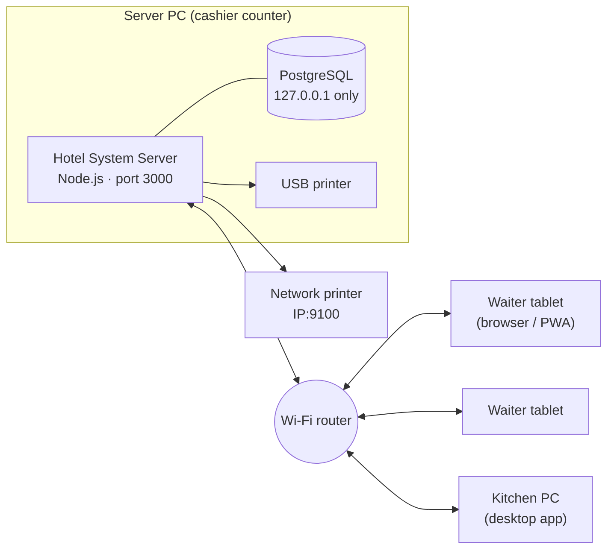
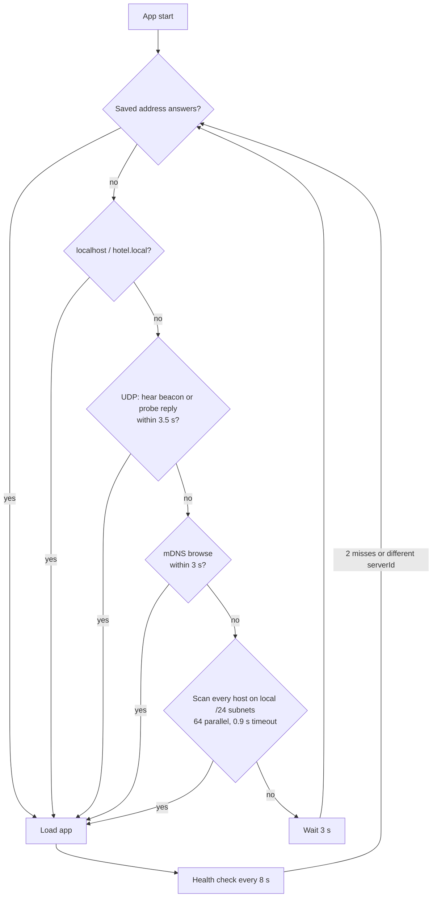
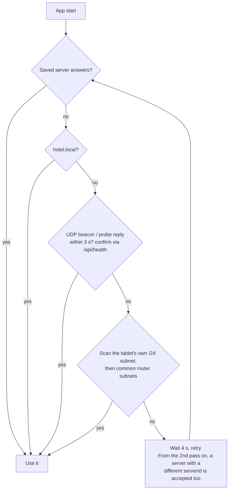

# Networking: how devices find and talk to the server

Hotel System runs entirely on the restaurant's local network (LAN / Wi-Fi). No internet is required at any point after installation.

## 1. Topology

One PC is the **server** (normally the cashier counter). Everything else is a **client**.



- **One process serves everything** on a single port (default `3000`):
  - the web app (`/`)
  - the REST API (`/api/*`)
  - realtime updates (`/socket.io`)
  - the Android app download (`/downloads/hotel-system.apk`)
- **The database is never exposed.** PostgreSQL listens on `127.0.0.1` only. Clients talk to the API, never to the database.
- **All print jobs are queued on the server.** A waiter tablet sends "print kitchen slip" to the API. The server renders ESC/POS and either sends it itself (USB on the server PC, or LAN printer on port 9100) or hands the bytes to an **Additional PC desktop print agent** for a local USB printer. Tablets never need printer drivers.

## 2. Ports

| Port | Protocol | Purpose | Who listens |
|------|----------|---------|-------------|
| 3000 | TCP | Web app, API, WebSocket | Server (all interfaces) |
| 41234 | UDP | Discovery beacon (server → broadcast) | Desktop and Android clients |
| 41235 | UDP | Discovery probe (client → server) | Server |
| 5353 | UDP | mDNS (`hotel.local`) | Server, desktop clients |
| 5433 | TCP | PostgreSQL | Server, **localhost only** |
| 9100 | TCP | Raw printing to network printers | Printer |

If port 3000 or 5433 is already taken, the installer picks the next free port (3080/8080, 5434…) and saves the choice in `C:\ProgramData\HotelSystem\hotel.env`.

The installer adds Windows Firewall rules (all profiles) for:

- TCP on the web port
- UDP 41234–41235
- the server's `node.exe`
- the desktop app

## 3. Server identity

On first start the server generates a permanent **server ID** (UUID) and stores it in the database (`Setting` table, key `server.id`). It does not change when:

- the IP address changes
- the PC is renamed
- the app is upgraded

It only changes if the database is wiped.

Every client remembers the server ID of the server it first connected to. This is how a client recognises "its" server after an IP change. It also stops a client from attaching to a different restaurant's server, or to a test server on the same network.

`GET /api/health` (no login needed) returns the identity:

```json
{ "ok": true, "app": "hotel-system", "serverId": "6d027b94-…", "name": "Main Counter", "version": "1.0.0", "port": 3000 }
```

## 4. How a client finds the server

The server advertises itself three ways at once:

1. **UDP beacon:** every 2 seconds it broadcasts `{app, serverId, name, port}` to `255.255.255.255:41234` and to each network interface's broadcast address.
2. **UDP probe responder:** it answers any packet sent to port 41235 that contains `hotel-system`.
3. **mDNS:** it publishes `hotel.local` plus an HTTP service record (`txt: app=hotel-system, serverId=…`).

### Desktop app (Electron)

The desktop app never shows a "server address" field. On start it runs these steps and stops at the first match whose server ID equals the saved one. On first run, any Hotel System server matches.



The new address is saved to `%APPDATA%\Hotel System\config.json`. The menu has **Reconnect to server** (run discovery now) and **Change server…** (forget the saved server and pin a new one).

After connecting, the packaged desktop app compares its local `VERSION` to the server. If the server is newer and `/downloads/desktop-update.zip` is present, it downloads the package over the LAN and replaces the install (Windows UAC once). The UI itself is always loaded from the server URL, so screens update even before the shell update finishes.

### Browser / tablet (PWA)

Browsers cannot send UDP or mDNS queries, so the web client uses HTTP probes only (`apps/web/src/server.ts`):

1. On load, it probes the address the page came from and pins that server ID.
2. When a request fails, a full-screen "Connecting to server…" overlay appears and the client tries, in order:
   1. the saved origin
   2. the page's own origin
   3. `hotel.local`
   4. a scan of the last-known /24 subnet and common router subnets, 48 parallel probes
3. When the server is found, the client switches the API and WebSocket base to the new address, with no reload needed.
4. **Enter address** in the overlay lets staff type an IP manually as a last resort.

**Known limitation:** the steps above only run while the app is open. A tablet's home-screen icon points to a fixed URL such as `http://192.168.1.10:3000`. If the server's IP changes while the tablet is off, that icon opens a dead address. This is why a **DHCP reservation** (section 6) is part of every installation. Opening the app through `http://hotel.local:3000` also avoids it on devices that resolve mDNS names. Recent iOS and Windows versions do; Android support varies.

Service-worker offline caching needs HTTPS or `localhost`. On a plain-HTTP LAN address, tablets get the reconnect behaviour above but not an offline app shell.

### Android app

The PWA's weak points on Android are exactly the ones above: the home-screen icon is bound to one IP address, Chrome cannot send UDP, and many Android versions do not resolve `hotel.local`. The Android app (`apps/mobile`, Capacitor) removes all three:

- **The UI is inside the APK.** The app opens instantly, even when the server is off, and shows the "Connecting to server…" overlay instead of a browser error page. No address is tied to the icon.
- **A native plugin speaks UDP** (`HotelDiscoveryPlugin.java`). It holds a Wi-Fi multicast lock, listens on port 41234 for the server's beacon, and sends a broadcast probe to port 41235. The server answers within milliseconds.
- **The subnet scan uses the tablet's real IP** (read natively), not a guess.



The found address is saved in the app's storage. Every API call and the WebSocket go to it directly; the server allows this cross-origin access (CORS). Login and permissions work exactly as in the browser.

From the second pass on, the app also accepts a server whose ID changed. This covers a reinstalled server or a reset database, which would otherwise leave the tablet stuck. The desktop app does the same.

**Install:** *Settings → Server* shows an **Android app** QR code once the server has an APK (the installer ships it). Scan it with the tablet camera, open the downloaded `hotel-system.apk` and allow *Install unknown apps* for the browser. Updates install the same way, over the old app; login data is kept.

**Permissions requested:** network access and Wi-Fi multicast only. No location, no storage, no camera.

## 5. Realtime updates

Clients connect to Socket.IO at `/socket.io` with their login token. The server places each connection into rooms based on the user's permissions:

| Room | Who | Events |
|------|-----|--------|
| `all` | everyone | `orders.changed` |
| `kitchen` | `kitchen.view` | `kitchen.new` (new order or items added; the kitchen screen beeps) |
| `cashier` | `order.pay` or `bill.view` | `bill.requested`, `order.ready` |
| `print` | `order.pay`, `print.bill` or `printers.manage` | `print.failed` |
| `user:<id>` | the individual user | `order.ready` (the waiter's own orders), `print.done`, `print.failed` for their own requests |

If the socket fails to connect three times in a row, it triggers the same server search as a failed API call.

## 6. Installing on a real restaurant network

1. **Pick the server PC.** Use the cashier PC that stays on all day, preferably on a wired (Ethernet) connection to the router.
2. **Reserve its IP in the router.** Open the router admin page (usually `192.168.1.1` or `192.168.0.1`) and go to *DHCP → Address Reservation / Static Lease*. Bind the server PC's MAC address to its current IP. This is the single most important step for stable tablets.
3. **Run the installer on the server PC** and choose *Main PC: server + desktop app*. The installer:
   - sets up the database and server as Windows services that start at boot
   - opens the firewall
   - shows the addresses tablets should use
4. **Other PCs:** run the same installer and choose *Additional PC: desktop app only*. They find the server on their own.
5. **Tablets:** join the restaurant Wi-Fi and scan the **Android app** QR code on *Settings → Server* to install the app (recommended). iPads and other devices: scan the web address QR code instead and choose *Add to Home screen*.
6. **Staff:** under *Users*, create one account per person (with a PIN for tablet users), then disable the demo accounts.
7. **Printers:** go to *Settings → Printers*.
   - USB printer on the server PC: install its Windows driver, then pick it from the list.
   - Network printer: enter its IP. Port 9100 is the default.
   - Use **Test print** to confirm.

### Wi-Fi requirements

- All devices must be on the **same network / subnet**. A *guest* Wi-Fi network usually blocks device-to-device traffic, so keep staff devices off it.
- **Client isolation / AP isolation** must be **off** on the access point.
- If the router has separate 2.4 GHz and 5 GHz networks, they must bridge to the same LAN. This is the default on almost all home and SMB routers.

## 7. Troubleshooting

| Symptom | Check |
|---------|-------|
| Tablet shows "Connecting to server…" forever | Is the server PC on? From the tablet, open `http://<server-ip>:3000/api/health`. If it doesn't load, the problem is Wi-Fi isolation or the firewall. |
| Desktop app stuck on "Searching the network" | Same health URL from that PC. Make sure both PCs are on the same subnet (the first three numbers of the IP match). |
| Works by IP but not by `hotel.local` | That device doesn't support mDNS. Use the IP or the QR code. |
| Android app can't find the server, browser on the same tablet can | Usually AP/client isolation blocking broadcasts; the app still falls back to the subnet scan. Use **Enter address** once; the app remembers it. |
| No "Android app" QR in Settings | The server has no APK in `app\downloads`. Rebuild the installer without `-SkipAndroid`. |
| Server PC can't print | *Settings → Print queue* shows the error. For USB printers, check the printer is online in Windows *Printers & scanners*. |
| Server not running | `services.msc` → **Hotel System Server** and **Hotel System Database** should both be *Running*. Logs are in `C:\ProgramData\HotelSystem\logs`. |

## 8. Development setup vs production

| | Development (`pnpm dev`) | Installed server |
|---|---|---|
| Web app | Vite dev server, port 3000 (proxies `/api` and `/socket.io`) | Served by the API, port 3000 |
| API | `nest start --watch`, port 4000 | Windows service, port 3000 |
| Database | `.dev/pgdata`, `localhost:5544` | `C:\ProgramData\HotelSystem\pgdata`, `127.0.0.1:5433` |
| Config | `apps/api/.env` | `C:\ProgramData\HotelSystem\hotel.env` |

In development, tablets on the same Wi-Fi can open `http://<your-pc-ip>:3000` (Vite listens on all interfaces). The API's beacon advertises port 4000, and the API also serves the last production build of the web app on that port.
